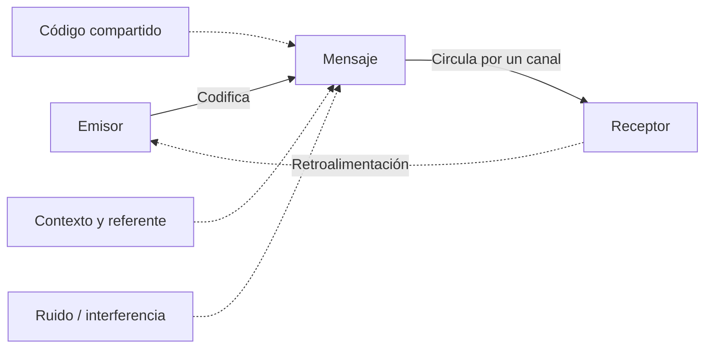
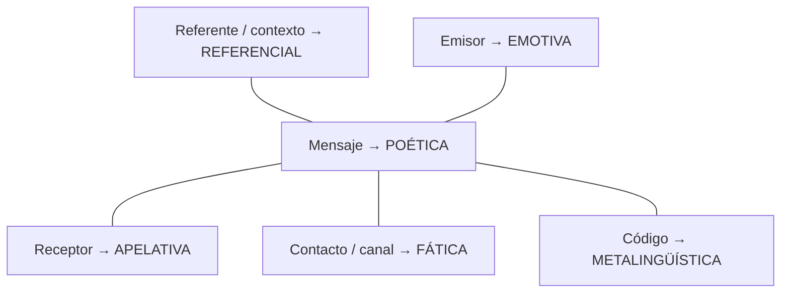

# Unidad 1. Lengua y comunicación

> **Objetivo de estudio.** Reconocer los elementos que intervienen en la comunicación e identificar la función predominante de un mensaje a partir de su intención y de la forma en que está construido.

**Estado del material:** borrador académico ampliado para revisión. Es una explicación original basada en el temario de las fotografías proporcionadas y en fuentes externas; **no sustituye ni reproduce íntegramente el libro**. Los siete reactivos originales permanecen en el documento base.

## Índice

1. Qué es comunicar.
2. Elementos de la comunicación.
3. Situación comunicativa, ruido y retroalimentación.
4. Las tres funciones centrales del temario: referencial, apelativa y poética.
5. Ampliación: emotiva, fática y metalingüística.
6. Cómo identificar la función predominante.
7. Análisis de los ejercicios originales.
8. Recursos visuales propuestos.
9. Fuentes y referencias.

---

## 1. ¿Qué significa comunicar?

**Comunicar** es producir e interpretar mensajes en una situación determinada. En su forma más elemental, existe alguien que expresa algo, un mensaje que circula y alguien que lo recibe. Sin embargo, una comunicación real también depende de las palabras o signos utilizados, del medio, del contexto y de los conocimientos que comparten los participantes. [F1, F2]

La comunicación **no se reduce a enviar información**. Podemos comunicar para explicar un hecho, solicitar ayuda, expresar alegría, crear un efecto artístico o comprobar que alguien nos escucha.

### Una misma situación, distintas intenciones

Imagina que la biblioteca va a cerrar:

- «La biblioteca cierra a las seis». **Se informa** un horario.
- «Por favor, sal antes de las seis». **Se solicita** una acción.
- «La tarde se despide entre libros». **Se destaca** la forma expresiva del mensaje.

Los tres enunciados pueden referirse a una misma situación, pero cumplen propósitos distintos.

## 2. Elementos de la comunicación

| Elemento | Pregunta guía | Ejemplo en un aviso escolar |
|---|---|---|
| **Emisor** | ¿Quién produce el mensaje? | La coordinación académica. |
| **Receptor** | ¿A quién se dirige? | El alumnado. |
| **Mensaje** | ¿Qué comunica? | «El examen será el lunes». |
| **Código** | ¿Qué sistema de signos utiliza? | La lengua española escrita. |
| **Canal** | ¿Por qué vía circula? | Un correo electrónico institucional. |
| **Referente** | ¿De qué trata? | La fecha del examen. |
| **Contexto** | ¿En qué circunstancias se interpreta? | El calendario del curso y el aviso previo a los estudiantes. |
| **Propósito** | ¿Para qué se comunica? | Informar la fecha de evaluación. |

El **referente** es aquello de lo que se habla; el **contexto** incluye las circunstancias que permiten interpretar correctamente lo dicho. En explicaciones escolares, ambos pueden aparecer próximos o con terminología parcialmente diferente, por lo que conviene observar cómo los emplea cada modelo. [F1, F2]

### Diagrama 1. Circuito comunicativo

**Matiz importante:** «oral» y «escrita» designan modalidades de expresión verbal; el canal es la vía material o técnica de transmisión, por ejemplo el aire, el papel, una llamada telefónica o una plataforma digital. El libro base presenta una versión simplificada de esta distinción. [F2, F4]

### Ejercicio resuelto: mensaje en un grupo escolar

Una docente escribe en el grupo de clase: «Entreguen mañana su proyecto en formato PDF».

- **Emisor:** la docente.
- **Receptores:** los estudiantes del grupo.
- **Mensaje:** la solicitud de entregar el proyecto al día siguiente en PDF.
- **Código:** lengua española escrita, junto con la convención de la sigla «PDF».
- **Canal:** la aplicación de mensajería y su infraestructura digital.
- **Contexto:** una actividad escolar ya asignada.
- **Función predominante:** **apelativa**, porque se busca que los destinatarios hagan algo.

La presencia de un dato («mañana») no convierte automáticamente el mensaje en referencial: hay que atender a su **propósito principal**.

## 3. Situación comunicativa, ruido y retroalimentación

### 3.1. El contexto cambia la interpretación

Piensa en el enunciado «Hace frío aquí»:

- Si alguien describe la temperatura durante una clase de ciencias, probablemente **informa**.
- Si lo dice mirando a una persona que está junto a la ventana abierta, podría estar **pidiendo indirectamente** que la cierre.
- Si lo pronuncia temblando y con frustración, también puede **expresar** su estado.

No basta con identificar palabras aisladas. La interpretación depende de quién habla, a quién y para qué. [F1, F4]

### 3.2. Ruido o interferencia

Se llama **ruido** a cualquier factor que dificulta que el mensaje sea recibido o interpretado como se pretendía. No siempre se trata de un sonido. [F3, F4]

| Tipo de interferencia | Ejemplo |
|---|---|
| Física | Una obra hace difícil escuchar una instrucción. |
| Técnica | Una llamada se entrecorta. |
| Semántica | El receptor desconoce la palabra «perífrasis». |
| Contextual | «Nos vemos allá» resulta ambiguo si no se ha mencionado el lugar. |

### 3.3. Retroalimentación

Es la respuesta que permite al emisor comprobar, corregir o continuar la interacción. Puede ser una pregunta, una respuesta oral, un gesto o un mensaje escrito.

Ejemplo:

1. Emisor: «La reunión empieza a las ocho».
2. Receptor: «¿A las ocho de la mañana?».
3. Emisor: «Sí, a las 8:00 a. m.».

La retroalimentación permite detectar una interpretación incompleta. En una conversación, los participantes pueden intercambiar continuamente los papeles de emisor y receptor. [F1, F3]

## 4. Las tres funciones centrales del libro

Una **función del lenguaje** describe hacia qué factor de la comunicación se orienta especialmente un mensaje. Jakobson distingue seis grandes funciones, pero el libro base se concentra en tres: referencial, apelativa y poética. [F2, F4, F5]

### 4.1. Función referencial, representativa o informativa

**Definición:** se centra en el referente o contexto y busca comunicar información acerca de hechos, situaciones, propiedades o acontecimientos.

**Pregunta guía:** ¿el mensaje intenta principalmente **informar o describir**?

Ejemplos nuevos:

1. «Un triángulo tiene tres lados» — enunciado que describe una propiedad geométrica.
2. «El laboratorio abrirá a las nueve» — aviso de horario.
3. «La muestra contiene tres componentes» — informe de un resultado.
4. «La actividad se realizó el miércoles» — narración de un hecho.

**Claves de reconocimiento:** enunciados declarativos, datos, descripciones, informes y explicaciones. Estos indicios **no son reglas infalibles**: un texto puede contener datos y estar diseñado principalmente para persuadir.

**Una precisión:** la función referencial no garantiza por sí sola que un enunciado sea verdadero ni completamente objetivo. «La Luna está hecha de queso» es una afirmación acerca del mundo y puede tener una orientación referencial, aunque sea falsa. La función describe la orientación del mensaje, no su grado de veracidad.

**Contraste:**

- «El examen comienza el lunes» → referencial.
- «Estudia hoy para el examen del lunes» → apelativa.
- «El lunes llega con sus preguntas afiladas» → poética.

### 4.2. Función apelativa o conativa

**Definición:** se centra en el receptor y pretende influir en su respuesta, conducta, atención, creencias o decisiones. [F4]

**Pregunta guía:** ¿el mensaje busca que el destinatario **haga, responda, acepte o considere** algo?

Ejemplos nuevos:

1. «Cierra la ventana, por favor» — petición directa.
2. «¿Podrías revisar este párrafo?» — solicitud formulada como pregunta.
3. «No olvides llevar tu identificación» — recordatorio con intención de orientar una acción.
4. «Participa en la jornada de lectura» — invitación.
5. «Si quieres comprender mejor el tema, practica con ejemplos distintos» — consejo argumentado.

**Claves de reconocimiento:** imperativos, vocativos, preguntas dirigidas a alguien, recomendaciones, invitaciones y enunciados persuasivos.

La función apelativa **no exige el imperativo**. Una petición indirecta o un argumento publicitario pueden tener la misma orientación. Sin embargo, tampoco **toda opinión es automáticamente apelativa**: debemos identificar una intención de influir en el receptor.

**Contraste:**

- «La puerta permanece abierta» → referencial.
- «Cierra la puerta» → apelativa.
- «La puerta bosteza frente al viento» → poética.

### 4.3. Función poética o estética

**Definición:** se centra en la **forma del mensaje**: cómo se eligen y combinan los sonidos, las palabras y las estructuras para producir un efecto expresivo. [F2, F4]

**Pregunta guía:** ¿la manera de decirlo tiene una importancia especial, además de lo que se comunica?

Ejemplos nuevos:

1. «La lluvia dibuja caminos en la ventana» — personificación e imagen visual.
2. «Su voz era un hilo de luz» — metáfora.
3. «El viento va y viene, vuelve y se va» — repetición y ritmo.
4. «Del cielo callado cayó la claridad» — aliteración.

**Recursos frecuentes:** metáfora, símil, personificación, repetición, paralelismo, ritmo, rima, aliteración e inversión del orden habitual.

La función poética **no aparece únicamente en los poemas**. Puede existir en anuncios, lemas, conversaciones y discursos. Tampoco basta con que una frase mencione la poesía para que su función predominante sea poética.

**Contraste:**

- «La noche comenzó a las siete» → referencial.
- «Apaga las luces al anochecer» → apelativa.
- «La noche abrió su manto sobre la ciudad» → poética.

### 4.4. Tabla comparativa para memorizar

| Función | Se centra en… | Intención central | Pregunta clave |
|---|---|---|---|
| **Referencial** | Referente / contexto | Informar | «¿Qué sucede?» |
| **Apelativa** | Receptor | Influir o solicitar una respuesta | «¿Qué debo hacer?» |
| **Poética** | Mensaje | Destacar la expresión | «¿Cómo está dicho?» |

## 5. Ampliación: tres funciones adicionales

Estas tres funciones **no aparecen en la unidad de tu libro**, pero completan el modelo de seis funciones de Jakobson. Conviene conocerlas para evitar clasificaciones incorrectas y comprender mejor la comunicación. [F2, F4, F5]

### 5.1. Emotiva o expresiva

Se centra en el **emisor** y pone de relieve sus emociones, sentimientos, valoraciones o actitudes.

- «¡Qué alegría volver a verte!»
- «Estoy nervioso por el examen».

**Diferencia con la poética:** expresar un sentimiento no significa necesariamente que exista una elaboración especial de la forma verbal.

### 5.2. Fática o de contacto

Se centra en el **contacto o canal de comunicación**. Sirve para iniciarlo, verificarlo, mantenerlo o terminarlo.

- «¿Bueno? ¿Me escuchas?»
- «Ajá, te sigo escuchando».
- «Hasta luego».

**Diferencia con la apelativa:** «¿Me escuchas?» puede solicitar una respuesta, pero su propósito habitual es **verificar el contacto**.

### 5.3. Metalingüística

Se centra en el **código**: usamos el lenguaje para explicar o preguntar por el propio lenguaje.

- «La palabra “árbol” es un sustantivo».
- «¿Qué significa “conativa”?».
- «“Veloz” y “rápido” son sinónimos en muchos contextos».

**Diferencia con la referencial:** se habla específicamente de palabras, reglas y significados del código lingüístico.

### Diagrama 2. Correspondencia entre funciones y elementos

## 6. Cómo identificar la función predominante en un examen

**El criterio decisivo no es la palabra aislada, sino la intención principal del enunciado y la atención que presta a sus elementos.** Un mensaje puede reunir simultáneamente varias funciones; en el examen elegimos la predominante. [F4, F5]

### Método en cuatro preguntas

1. **¿Qué quiere lograr el emisor?** Informar, provocar una reacción, expresar algo o cuidar la forma del mensaje.
2. **¿Hacia quién o qué se orienta?** Referente, receptor, mensaje, emisor, canal o código.
3. **¿Qué rasgos lo apoyan?** Datos, peticiones, imágenes literarias, emociones, comprobación de contacto o definiciones lingüísticas.
4. **¿Qué opción es la más convincente en ese contexto?** Descarta las alternativas cuyas señales sean secundarias.

### Caso de análisis: mensaje mixto

«¡Cuida el agua: cada gota cuenta!».

- **Apelativa:** «Cuida» pide una conducta.
- **Poética:** «cada gota cuenta» utiliza una fórmula breve y expresiva.
- **Referencial:** alude a un recurso real, el agua.

En un cartel de concienciación, la función **predominante es apelativa**, porque busca modificar la conducta de quien lo lee. Que un mensaje sea ingenioso no elimina su propósito persuasivo.

### Señales que pueden confundir

| Interpretación precipitada | Corrección |
|---|---|
| «Toda pregunta es apelativa». | Algunas preguntan por el código, otras verifican el contacto y otras buscan una acción. |
| «Toda oración con datos es referencial». | Los datos también pueden aparecer como apoyo en un discurso persuasivo. |
| «Si menciona un poema, es poética». | Hablar *sobre* un poema no es lo mismo que elaborar poéticamente el mensaje. |
| «Toda frase emotiva es poética». | Una emoción puede expresarse con palabras sencillas, sin elaboración formal especial. |
| «Si hay metáfora, ya no existe ninguna otra función». | La metáfora puede servir a un mensaje cuyo objetivo principal sea persuadir. |

## 7. Comentarios académicos sobre los siete ejercicios originales

**Nota editorial:** la clave del libro es `1-A, 2-B, 3-C, 4-B, 5-C, 6-B, 7-C`. A continuación se ofrece una interpretación pedagógica, pero **no se reemplaza** la clave original.

| Reactivo | Clave del libro | Comentario pedagógico |
|---|---|---|
| 1 | A | El enunciado elegido emite una valoración crítica frente a otras opciones más descriptivas. La interpretación como apelativa **supone una intención persuasiva**; sin contexto más amplio, resulta un reactivo menos nítido que una petición directa. |
| 2 | B | El interés está en la construcción expresiva del enunciado; la opción D es una petición y, por tanto, típicamente apelativa. |
| 3 | C | El ritmo, la personificación y la repetición destacan la forma del mensaje. |
| 4 | B | El orden expresivo de las palabras predomina sobre la información literal. |
| 5 | C | Su formulación busca influir en la actitud del destinatario; es una apelación **indirecta**. |
| 6 | B | Funciona como afirmación dirigida a modificar una creencia o actitud, según el criterio persuasivo del libro. |
| 7 | C | El enunciado sobre la autosugestión puede leerse como persuasivo o exhortativo **por su intención probable**; aislado de su texto completo también tiene aspecto expositivo. Conviene marcarlo para revisión editorial, no presentarlo como ejemplo inequívoco. |

**Decisión para Folio:** conservar siempre `respuesta_original` y, cuando corresponda, `observacion_editorial`. Para el banco nuevo, priorizar preguntas con una respuesta defendible y sin ambigüedades innecesarias.

## 8. Recursos visuales propuestos para Folio

No es necesario insertar imágenes decorativas. Cada recurso debe resolver una dificultad específica del contenido.

| ID | Lugar | Recurso recomendado | Implementación |
|---|---|---|---|
| FIG-01 | Sección 2 | Circuito de comunicación, con retroalimentación y ruido | Mermaid o SVG original. |
| FIG-02 | Sección 4 | Comparación en tres columnas: informar, persuadir, crear efecto expresivo | SVG original con tonos pastel suaves. |
| FIG-03 | Sección 5 | Correspondencia de los seis factores con las seis funciones | Mermaid o SVG original. |
| FIG-04 | Sección 6 | Una misma escena escolar con tres mensajes distintos | Ilustración opcional; preferir SVG con texto. |

**Fuentes de referencia visual:** los recursos de la UNAM [F2], [F4] y [F5] contienen esquemas educativos de comunicación. **No reutilizar sus imágenes automáticamente**; comprobar antes las condiciones de uso. Es más sencillo generar diagramas vectoriales originales basados en las relaciones conceptuales.

## 9. Referencias bibliográficas y recursos consultados

**[F1] UNAM, Portal Académico del CCH.** «Situación comunicativa». Se explican emisor, receptor, código, referente, contexto y propósito comunicativo.  
https://portalacademico.cch.unam.mx/alumno/tlriid1/unidad2/distintosDestinatarios/situacionComunicativa

**[F2] Islas Ochoa, Brenda María (2019).** «El lenguaje y sus funciones». Unidad de Apoyo para el Aprendizaje, CUAED/FES Acatlán, UNAM. Presenta los seis tipos de funciones y ejemplos.  
https://repositorio-uapa.cuaed.unam.mx/repositorio/moodle/pluginfile.php/1427/mod_resource/content/1/contenido/index.html

**[F3] UNAM, Colegio de Ciencias y Humanidades.** *Teoría de la comunicación*, guía didáctica. Incluye retroalimentación, interferencias y elementos del circuito comunicativo.  
https://portalacademico.cch.unam.mx/materiales/al/Guias_extras/Talleres/com1_val.pdf

**[F4] Mejía Guzmán, Antonio (2018).** «Dinámica de la comunicación en la escritura». Unidad de Apoyo para el Aprendizaje, CUAED/FES Acatlán, UNAM. Presenta el circuito y la correspondencia de funciones y factores.  
https://repositorio-uapa.cuaed.unam.mx/repositorio/moodle/pluginfile.php/1603/mod_resource/content/8/contenido/index.html

**[F5] Zabadúa Valencia, María de Lourdes, y García Palacios, Ernesto.** *Cómo enseñar a hablar y escuchar en el salón de clases*. Colegio de Ciencias y Humanidades, UNAM, colección 2012, capítulo I, apartado «Funciones de la lengua», p. 29.  
https://portalacademico.cch.unam.mx/materiales/libros/pdfs/librocch_hablarescuchar.pdf

### Bibliografía académica para profundizar después

- Jakobson, Roman. *Ensayos de lingüística general*. Referencia teórica de las seis funciones; consultar una edición bibliográfica antes de fijar páginas.
- Ávila, Raúl. *La lengua y los hablantes*. Obra recomendada en [F2].

## 10. Control editorial pendiente

- [ ] Registrar título, autor, editorial, edición y páginas del libro original.
- [ ] Revisar el contexto de los reactivos 1 y 7 del libro; conservar la clave original mientras tanto.
- [ ] Validar y publicar los dos diagramas Mermaid con el diseño definitivo de Folio.
- [ ] Verificar que los componentes visuales se ajusten a la plantilla MDX efectiva del proyecto.
- [ ] Revisar preguntas nuevas antes de incorporarlas al banco estable.
- [ ] Registrar la fecha de última revisión académica de esta versión.

---

*Contenido ampliado y ejemplos redactados expresamente para el proyecto Folio. Las fuentes externas están citadas como referencia de investigación, no como material reproducido.*
