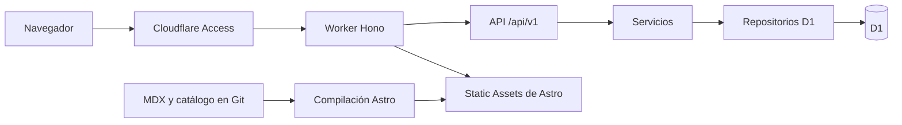

# Arquitectura

## Un proyecto, un Worker

Astro produce HTML y assets estáticos en dist. No hay adaptador SSR, servidor Node de producción ni conexiones SQLite tradicionales. React solo se hidrata en evaluaciones, progreso, repaso y preferencias.



assets.run_worker_first es true para TODAS las rutas: la biblioteca completa es privada, incluidas lecturas, JSON y recursos. Después de validar Access, Hono procesa /api/* y delega las demás rutas a env.ASSETS.fetch. Esto conserva el prerenderizado y añade una comprobación de privacidad por solicitud.

Las respuestas de ASSETS tienen encabezados inmutables. Se clonan antes de aplicar secureHeaders. El binding de assets se declara también en env.local, ya que Wrangler no lo hereda en este entorno. Ambos detalles se verifican con pruebas de navegador sobre Wrangler, además del dry-run.

APP_ENV=development permite únicamente hosts de loopback en el entorno local. Producción verifica RS256, emisor y audiencia con jose y las claves públicas de Access. La ausencia de configuración produce 503; un JWT ausente o inválido produce 401. Los endpoints no admiten IDs de estudiante del cliente. El ID interno inicial es local-student.

Cache-Control es private, no-store. Se aplican CSP, protección de marcos, restricciones de permisos y validación de origen para escrituras. La CSP permite scripts y estilos inline necesarios para Astro, KaTeX y Mermaid; no permite scripts remotos, objetos ni marcos. El MDX sigue siendo código de confianza.

## Fronteras de código

| Directorio          | Responsabilidad                                      |
| ------------------- | ---------------------------------------------------- |
| src/pages           | Páginas estáticas y rutas generadas                  |
| src/components      | Islas React y componentes académicos                 |
| content             | Catálogo, lecturas MDX, banco y tarjetas versionados |
| shared              | Esquemas, catálogo público y utilidades              |
| server/routes       | HTTP y validación de payloads                        |
| server/services     | Selección, intentos, diagnóstico                     |
| server/repositories | SQL parametrizado y consistencia                     |
| migrations          | Evolución del esquema                                |
| tests               | Contenido, API con D1 y E2E                          |

El frontend importa tipos de la API mediante import type. Las importaciones del banco y sus claves se quedan en el servidor. Astro descubre MDX con glob desde content/books; genera rutas por topicId.

Los documentos originales de integración se conservan en content/editorial, fuera del descubrimiento y de los assets. Las preguntas en content/drafts/questions se validan, pero nunca se importan en el Worker ni se incluyen en la selección. El catálogo solo comunica su conteo pendiente y estado editorial.

El temario básico de content/syllabus.json agrupa 74 apartados en diez cuadernos. readingTopicIds enlaza las lecturas disponibles de cada apartado. El generador solo ofrece preguntas existentes; un apartado pendiente nunca equivale a un capítulo inventado.

## API v1

Todos los endpoints están detrás del mismo perímetro.

| Método   | Ruta                    | Función                                      |
| -------- | ----------------------- | -------------------------------------------- |
| GET      | /health                 | Salud de Hono                                |
| GET      | /catalog                | Catálogo público con conteos                 |
| GET      | /books, /topics         | Metadatos editoriales                        |
| POST     | /exams                  | Configurar y crear intento                   |
| GET      | /attempts               | Historial reciente                           |
| GET      | /attempts/:id           | Preguntas autorizadas y respuestas guardadas |
| POST     | /attempts/:id/answers   | Guardar una opción                           |
| POST     | /attempts/:id/finish    | Cierre y calificación idempotentes           |
| GET, PUT | /progress               | Consultar o registrar lectura                |
| GET      | /analytics              | Diagnóstico determinista                     |
| GET, PUT | /profile                | Preferencias del perfil interno              |
| GET      | /flashcards             | Tarjetas con historial                       |
| POST     | /flashcards/:id/reviews | Registrar revisión                           |

Ejemplo de configuración:

```json
{
  "topicIds": ["ecuaciones-lineales", "acentuacion"],
  "count": 5,
  "mode": "exam",
  "selection": "cumulative",
  "timeLimitMinutes": 20
}
```

Modos: practice y exam. Selección: random, unseen, errors y cumulative. Aleatorio y acumulativo usan cobertura equilibrada por tópico con colas barajadas. Acumulativo permite mezclar cualquier libro o materia seleccionada. Priorizar errores ordena por número histórico de fallos y desempata al azar. Si no hay suficientes preguntas, la API rechaza la configuración con 422.

Los reactivos se congelan en el intento. Práctica devuelve feedback solo del reactivo ya respondido y conserva la primera opción. Simulacro admite cambios hasta finalizar o agotar el tiempo y nunca devuelve feedback en curso. El servidor fija el plazo; el reloj del navegador se ajusta con serverNow. Los reactivos sin respuesta cuentan como incorrectos.

No vistas excluye todos los reactivos entregados a cualquier intento del estudiante, incluidos los intentos en curso. El diagnóstico de aciertos y errores utiliza solamente intentos finalizados. La cobertura cuenta los IDs del banco actual que ya se entregaron; no incluye preguntas retiradas. El historial muestra los cien intentos más recientes y el diagnóstico considera la historia completa.

El despliegue inicial cerrado permite crear el Worker gratuito antes de activar Access. Solo muestra una página de estado sin contenido de la biblioteca; la API devuelve 503 incluso para escrituras. La publicación funcional requiere configurar Access y verificar una sesión autorizada. No se usa ctx.access porque Static Assets introduce un router que actualmente no transmite ese contexto al Worker del usuario; se valida el JWT directamente.

Las respuestas de error tienen error.code y error.message. La validación añade error.details sin reproducir los valores enviados.

## Fuentes técnicas

- [Astro](https://docs.astro.build/en/install-and-setup/)
- [Worker-first routing](https://developers.cloudflare.com/workers/static-assets/routing/worker-script/)
- [D1 batch](https://developers.cloudflare.com/d1/worker-api/d1-database/)
- [Access para Workers](https://developers.cloudflare.com/workers/configuration/cloudflare-access/)
- [Validación de JWT](https://developers.cloudflare.com/cloudflare-one/access-controls/applications/http-apps/authorization-cookie/validating-json/)

Se consultaron versiones estables mediante npm el 9 de noviembre de 2026. package-lock.json fija el árbol probado. TypeScript 6 se usa porque Astro Check todavía no admite TypeScript 7. eslint-plugin-astro 1.7 es compatible con Node 24.13.1; las versiones recientes del plugin requieren Node 24.16. Se actualizan KaTeX y minimatch indirectos mediante overrides, verificados por pruebas y npm audit.
